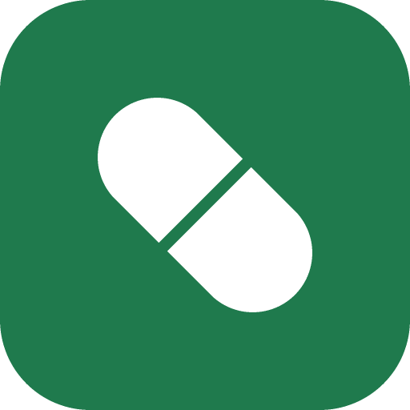
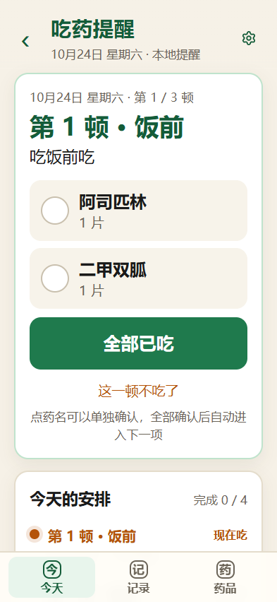
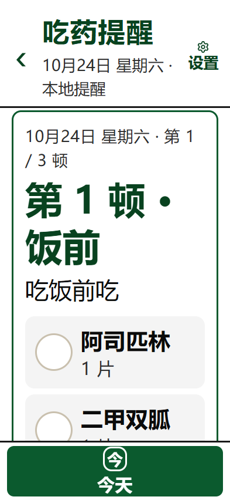
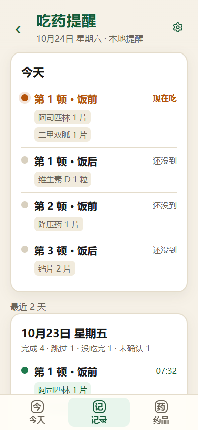
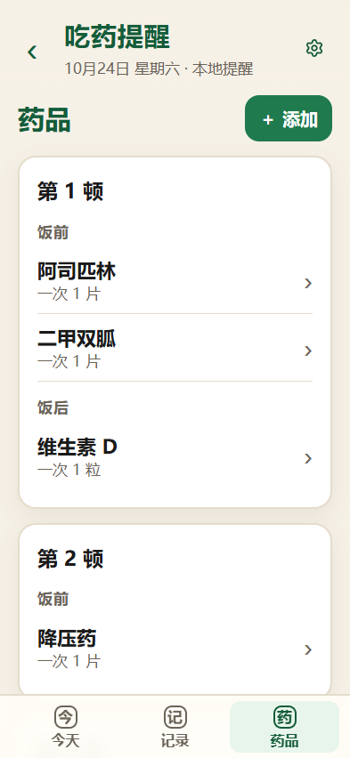
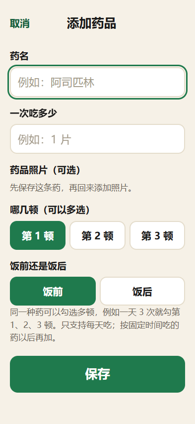
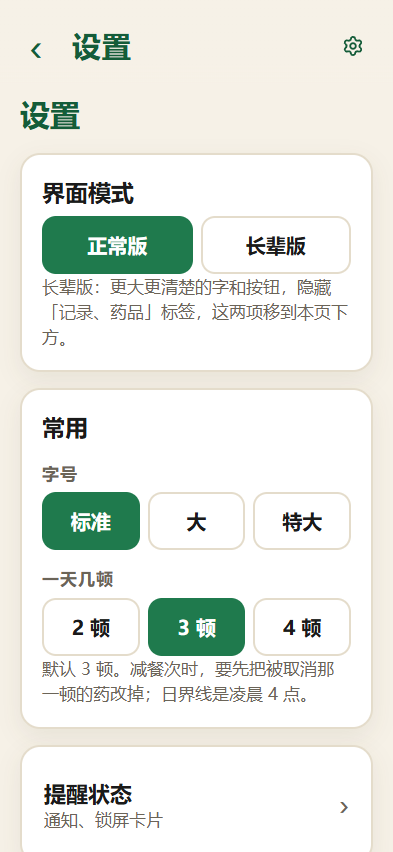
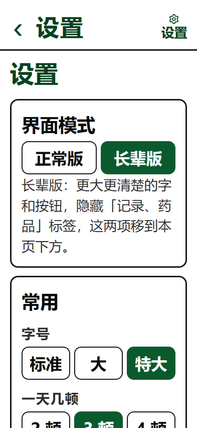

# 吃药提醒 · Medication Reminder

<p>
  
</p>

[English](#english) | [简体中文](#简体中文)


面向长辈的本地服药提醒：按「第 1 顿·饭前 → 第 1 顿·饭后 → 第 2 顿·饭前……」的顺序推进，不依赖固定饭点。
完全离线，无 `INTERNET` 权限，数据只存在手机本地。

| 今天 | 今天（长辈版） | 记录 |
|---|---|---|
|  |  |  |

| 药品 | 添加药品 | 设置 |
|---|---|---|
|  |  |  |

> 截图为界面预览（长辈版设置页：）。

## 简体中文

### 特性

- **餐次状态机**：第 1 顿·饭前 → 第 1 顿·饭后 → 第 2 顿·饭前……；空阶段自动跳过；支持逐种确认、全部确认、跳过本项。
- **两种界面**：正常版与长辈版。长辈版高对比、更大字和按钮，隐藏次要入口（记录、药品移入设置二级页）。
- **常驻通知**：通知栏显示当前阶段和剩余药品，一键确认；被划掉后自动补发。
- **锁屏卡片**：基于无障碍 `TYPE_ACCESSIBILITY_OVERLAY`，锁屏上可直接确认；不读取屏幕内容。
- **撤销**：10 分钟内可撤销最近一次确认。
- **记录**：按天结算（已完成 / 已跳过 / 没吃完 / 未确认），保留最近 14 天与每日汇总。
- **备份**：导出 / 恢复到本地 JSON 文件（系统文件选择器，不申请存储权限）。
- **药品照片**：可选，本地保存，作为辅助识别；不替代药名文字。
- **权限克制**：只有通知、开机自启、震动；无网络、无相机、无存储权限。

### 安装

- 系统要求：Android 8.0（API 26）及以上。
- 从 [Releases](https://github.com/waste114514/chiyaotixing/releases) 下载 APK，安装时允许「安装未知应用」。
- 建议核对发布说明里的 SHA-256 与签名证书指纹。

首次使用建议顺序：设置 → 数据 → 从备份恢复（如有）→ 添加药品 → 允许通知 → 开启「锁屏吃药卡片」无障碍服务。

### 自行构建

前置：JDK 21、Android SDK（compileSdk 36）、Node.js 20+（Capacitor 8）。

```bash
npm install
npx cap sync android

# 调试包
cd android
./gradlew assembleDebug

# 正式包（需要签名配置）
cp keystore/keystore.properties.example keystore/keystore.properties  # 填写自己的 keystore
./gradlew assembleRelease
```

> `keystore/` 下的密钥与密码已加入 `.gitignore`，请勿提交或公开。

### 数据与隐私

- 应用无 `INTERNET` 权限，无法联网，不上传任何数据。
- 数据保存在应用私有目录 `files/med_data/`：
  - `plan.json` 药品、餐次、界面模式、照片显示方式
  - `state.json` 当天阶段与确认记录（含一步撤销）
  - `events-YYYY-MM.jsonl` 历史事件与每日结算
  - `photos/` 药品照片（压缩后的 JPEG）
- 卸载或「清除数据」会删除以上全部内容；系统云备份未启用（`allowBackup=false`）。
- 导出的备份是明文 JSON，包含药名与服药记录，请自行妥善保管。详见 [PRIVACY.md](PRIVACY.md)。

### 免责声明

本应用只负责提醒和记录，不提供医疗建议，用药方案请遵医嘱。

---

## English

**Medication Reminder** is a local-first Android reminder built around meals instead of fixed clock times:
*Meal 1 · before → Meal 1 · after → Meal 2 · before → …*
It is designed for elderly users and never connects to the internet — the app does not even request the `INTERNET` permission.

### Features

- **Meal-stage state machine**: skips empty stages, supports per-medicine confirmation, confirm-all, and skip-stage.
- **Two UI modes**: normal and care mode (higher contrast, larger text and buttons, fewer entries; records and medicines move into Settings).
- **Persistent notification** with one-tap confirmation; re-posts itself if swiped away.
- **Lock-screen card** via an accessibility overlay (`TYPE_ACCESSIBILITY_OVERLAY`); the service never reads screen content.
- **Undo**: one-step undo within 10 minutes.
- **Daily records**: done / skipped / partial / missed, with per-day summaries.
- **Backup**: export and restore to a local JSON file using the system file picker (no storage permission).
- **Optional medicine photos**, stored locally as an aid — never replacing the medicine name text.
- **Minimal permissions**: notifications, boot-completed, vibrate. No network, camera, or storage.

### Install

- Requires Android 8.0 (API 26) or newer.
- Download the APK from [Releases](https://github.com/waste114514/chiyaotixing/releases) and allow installing unknown apps.
- Verify the SHA-256 and signing certificate fingerprint from the release notes.

### Build

Requirements: JDK 21, Android SDK (compileSdk 36), Node.js 20+ (Capacitor 8).

```bash
npm install
npx cap sync android
cd android
./gradlew assembleDebug     # debug build
./gradlew assembleRelease   # release build (see keystore/keystore.properties.example)
```

### Privacy

- No `INTERNET` permission: the app cannot send anything anywhere.
- All data lives in the app's private storage (`files/med_data/`): `plan.json`, `state.json`, `events-YYYY-MM.jsonl`, `photos/`.
- Uninstalling or clearing app data removes everything; Android cloud backup is disabled (`allowBackup=false`).
- Exported backups are plain JSON containing medicine names and intake records — store them safely. See [PRIVACY.md](PRIVACY.md).

### Disclaimer

This app only reminds and records. It does not provide medical advice. Follow your doctor's instructions.

---

## License

[MIT](LICENSE) · Icons: [Lucide](https://lucide.dev) (ISC) · Third-party list: [docs/第三方许可.md](docs/第三方许可.md)